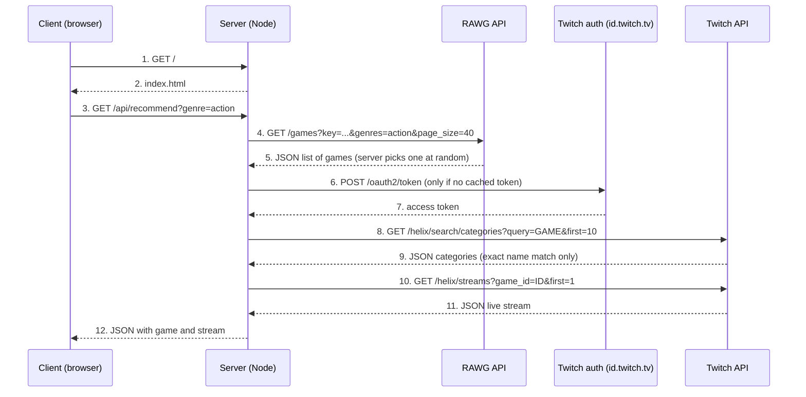

# Game + Stream Recommender 01/25/2025 - 05/20/2025 (College Project)

Stream Live Games is a full-stack web app that connects game discovery with live streaming. The user picks a genre, the app recommends a random game from the RAWG.io API, and then finds a live Twitch stream of that game through the Twitch API and embeds it on the page.

# How it works?
Pick a genre (or type your own) and get a random game from RAWG plus a live Twitch stream playing it. 

Frontend: HTML,CSS, JavaScript
Backend: Node.js APIs: RAWG.io API, Twitch API
Tools: VS Code, 

## Setup
1. `cp credentials.example.json credentials.json`
2. Fill in your RAWG API key and Twitch client ID/secret.
3. `npm start`, then open http://localhost:3000

## How it works

The browser then builds the page and loads the Twitch player iframe from `player.twitch.tv`.
